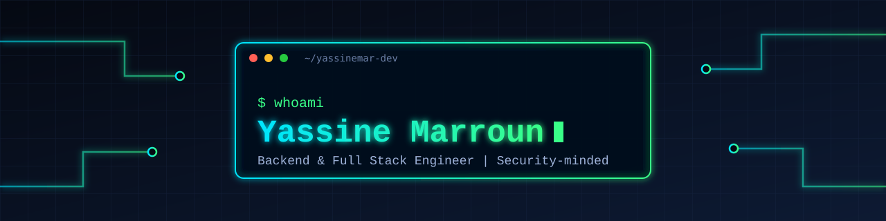

<div align="center">




</div>

---

## `> whoami`

```bash
$ cat about.txt
Name       : Yassine Marroun
Role       : Software Engineer (Backend & Full Stack)
Studying   : Information Systems Engineering @ SupMTI Rabat
Experience : 2+ years freelance (REST APIs, JWT/RBAC, Docker)
Location   : Salé / Rabat, Morocco
Languages  : Arabic, French, English
```

I design robust, scalable backends and full web apps, from architecture to deployment. My background in IT support and system administration makes me rigorous when it comes to debugging and incident resolution.

## `> stack`

**Languages**

<p>
  
  
  
  
  
  
  
  
</p>

**Backend**

<p>
  
  
  
  
  
  
  
</p>

**Frontend & Mobile**

<p>
  
  
  
  
  
</p>

**Databases**

<p>
  
  
  
  
</p>

**DevOps & Tools**

<p>
  
  
  
  
  
  
</p>

**AI & Data:** RAG, LLM, embeddings, web scraping

## `> projects`

| Project | What it is | Stack |
|---|---|---|
| **RAG Enterprise Assistant** | Chatbot that scrapes a company website, indexes the content and answers only from the extracted data. When the information is missing, it flags it and routes to the right contact. | Web scraping, RAG, LLM, embeddings, vector DB |
| **AtlasFlow** | B2B SaaS platform: scalable monorepo, analytics dashboard, secure RBAC auth, shared validation, containerized infra. | Next.js, NestJS, TypeScript, PostgreSQL, Prisma, Docker, JWT |
| **@ZAY** | Mobile marketplace with real-time two-way communication, push notifications and a secure multi-role backend. | React Native, Node.js, PostgreSQL, Socket.io, Firebase FCM |

> Source code coming soon, repositories are being cleaned up and published.

## `> currently`

- Studying Information Systems Engineering at SupMTI Rabat
- Building AI features with RAG and LLMs
- Publishing my projects on GitHub
- Open to freelance work and internship opportunities

## `> stats`

<div align="center">
  
  
</div>

## `> connect`

<p>
  <a href="mailto:yassinemardev@gmail.com"></a>
  <a href="https://www.linkedin.com/in/yassine-marroun-dev"></a>
</p>

<div align="center">

`while (alive) { learn(); build(); secure(); }`

</div>
